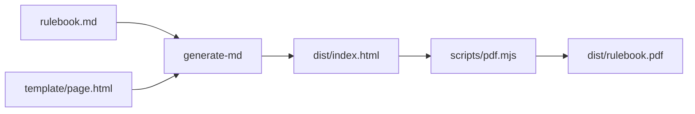

# rulebook

Rules for the Singapore AUV Challenge (SAUVC), published at [sauvc.org/rulebook](https://sauvc.org/rulebook/) as a web page and a [PDF](https://sauvc.org/rulebook/rulebook.pdf).

## Development

### Prerequisites

- [Node.js](https://nodejs.org/) 24 (see `.node-version`)
- [pnpm](https://pnpm.io/installation). The version is pinned in `package.json`, and pnpm switches to it automatically.
- [Google Chrome](https://www.google.com/chrome/), used headless to render the PDF. Set `CHROME_PATH` to use a different Chrome or Chromium binary.

### Build

```sh
pnpm install
make
```

This writes the web page and the PDF to `dist/`:

- `dist/index.html` and `dist/img/`
- `dist/rulebook.pdf`

`make clean` removes `dist/`.

### How it works



1. [markdown-styles](https://github.com/mixu/markdown-styles) (`generate-md`) turns `rulebook.md` into HTML using the layout in `template/page.html`.
2. `scripts/pdf.mjs` opens that page in headless Chrome through [playwright-core](https://playwright.dev/) and prints it to an A4 PDF with page numbers.

The page uses the stylesheet and font from [sauvc.org](https://sauvc.org), so the build needs network access. The PDF build fails if any stylesheet, font or image fails to load.

The PDF is printed with the screen styles, because the print styles on sauvc.org remove all colours. Page-break rules in `template/page.html` keep figures, table rows and headings from splitting across pages.

## Editing

- The rules are in `rulebook.md`. The front matter at the top sets `title`, `version`, `last_updated_date` and `year`, which appear on the cover.
- Images go in `img/`. Put a `<p class="image-caption">Caption.</p>` on the line after an image (``) to get a numbered figure caption.
- The table of contents in `rulebook.md` is maintained by hand. Update it when you add or rename a section.

## Versioning

The `version` in `rulebook.md` follows `YYYY.MAJOR.PATCH`.

- `YYYY` is the competition year, e.g. `2027`.
- `MAJOR` goes up when the rules change. It starts at `1` each year.
- `PATCH` goes up for fixes that don't change the rules, such as typos and wording. It resets to `1` when `MAJOR` goes up.

## Publishing

The [Build and Deploy](.github/workflows/deploy.yml) workflow builds the web page and PDF on every push and pull request.

- **Pull requests:** the output is attached to the workflow run as the `rulebook` artifact, so you can review the PDF before merging.
- **`master`:** the output is deployed to GitHub Pages.

Dependabot opens monthly pull requests to keep the GitHub Actions and npm dependencies up to date.
