title: The Singapore AUV Challenge 2027 Rulebook
version: "2027.2.1"
last_updated_date: 26 October 2026
year: 2027
---

<nav class="toc" aria-labelledby="contents">

## Contents

- [What's new in 2027](#whats-new-in-2027)
- [Scoring at a glance](#scoring-at-a-glance)
- [Key terms](#key-terms)
- [Objectives](#objectives)
- [Structure of the Team](#structure-of-the-team)
- [Video Submission](#video-submission)
- [Qualification](#qualification)
- [The Arena](#the-arena)
  - [Qualification Arena(s)](#qualification-arenas)
  - [Starting Zone](#starting-zone)
- [Tasks](#tasks)
  - [Navigation](#navigation)
  - [Target Acquisition](#target-acquisition)
  - [Target Reacquisition](#target-reacquisition)
  - [Communication \& Localization](#communication--localization)
  - [Surfacing](#surfacing)
  - [Aborting](#aborting)
  - [Automatic Abort](#automatic-abort)
  - [Timing Bonus](#timing-bonus)
  - [Penalties](#penalties)
  - [Examples](#examples)
- [Specification of AUV](#specification-of-auv)
  - [Size](#size)
  - [Power](#power)
  - [Safety](#safety)
  - [Communications](#communications)
- [Game Procedure](#game-procedure)
  - [Sequence of events during the competition](#sequence-of-events-during-the-competition)
  - [Practice Rounds](#practice-rounds)
  - [Length of a game](#length-of-a-game)
  - [Retries](#retries)
- [Certificate of Participation](#certificate-of-participation)
- [General Restrictions](#general-restrictions)
- [Disqualification](#disqualification)
- [Others](#others)
- [Feedback](#feedback)

</nav>

## What's new in 2027

Changes since the 2025 rulebook:

- **Video rules.** Videos must be 40 to 45 seconds long and show at least 20 seconds of untethered swimming in which the AUV dives, swims straight, turns 180° clockwise and swims back. The kill switch must be operated underwater. The deadline is 23:59 20th December, 2026, Anywhere On Earth. See [Video Submission](#video-submission).
- **Surfacing Square bonus.** Surfacing inside the new Surfacing Square, without touching it, earns 20 extra points. See [Surfacing Square Bonus](#surfacing-square-bonus).
- **Kill switch.** It must be the same kill switch shown in the video. See [Safety](#safety).

## Scoring at a glance

Points for a single attempt. The [Examples](#examples) show how they add up.

| What the AUV does | Points | Rule |
|:--|--:|:--|
| Passes through the gate | 15 | [Navigation](#navigation) |
| Drops the ball in the blue drum | 30 | [Target Acquisition](#target-acquisition) |
| Drops the ball in the red drum with the pinger | 50 | [Target Acquisition](#target-acquisition) |
| Drops the ball in any other red drum | 10 | [Target Acquisition](#target-acquisition) |
| Picks up its ball again and holds it until the end of the attempt | 60 | [Target Reacquisition](#target-reacquisition) |
| Makes the ball drop from a flare | 20 per flare | [Communication & Localization](#communication--localization) |
| Makes the balls drop from all 3 flares in the specified order | 60 extra | [Communication & Localization](#communication--localization) |
| Surfaces | 5 | [Surfacing](#surfacing) |
| Surfaces inside the Surfacing Square without touching it, after completing Navigation | 20 extra | [Surfacing Square Bonus](#surfacing-square-bonus) |
| Completes Navigation and at least one other task | (900 − run time in seconds) × 0.03 | [Timing Bonus](#timing-bonus) |
| Touches the gate | −2 | [Penalties](#penalties) |
| Touches the bottom or a wall of the pool | −5 | [Penalties](#penalties) |

The AUV can also earn a 10 point size bonus and a 10 point weight bonus at the size and weight check. They are added to the score of every attempt, but count only if the team passes the qualifying round. See [Size](#size).

## Key terms

| Term | Meaning |
|:--|:--|
| **Attempt** | One run of the AUV, from the starting zone until the end of the attempt. A game can have several attempts. Only the attempt with the highest score counts. |
| **End of the attempt** | The AUV surfaces, the team asks the Game Master to abort, or the attempt is automatically aborted. Points are counted at this moment. |
| **Game** | The 15 minutes a team has to complete the tasks, including all retries. |
| **Retry** | A new attempt in the same game. The AUV starts again from the starting zone with 0 points. |
| **Run time** | The time from when the AUV starts thrusting from the starting zone until the end of the attempt. Used for the [Timing Bonus](#timing-bonus). |
| Game Master | The official the team tells when it wants to abort an attempt. |
| Judges | The officials who check AUVs, approve retries and decide anything this rulebook does not cover. |
| **Communication equipment** | Underwater equipment is carried on the AUV and counts as part of it. Top-side equipment stays in the starting zone. See [Communications](#communications). |

The rulebook highlights terms like this:

- 15 Points: points awarded
- −5: penalty points
- end of the attempt: when an attempt ends
- abort: the attempt is stopped early
- Judges: competition officials
- red: the colour of a prop

## Objectives

The goal is for each team to develop an Autonomous Underwater Vehicle (AUV) which can negotiate the tasks put forth under a prescribed time and at the same time, to learn about underwater robotics and have fun in the process.

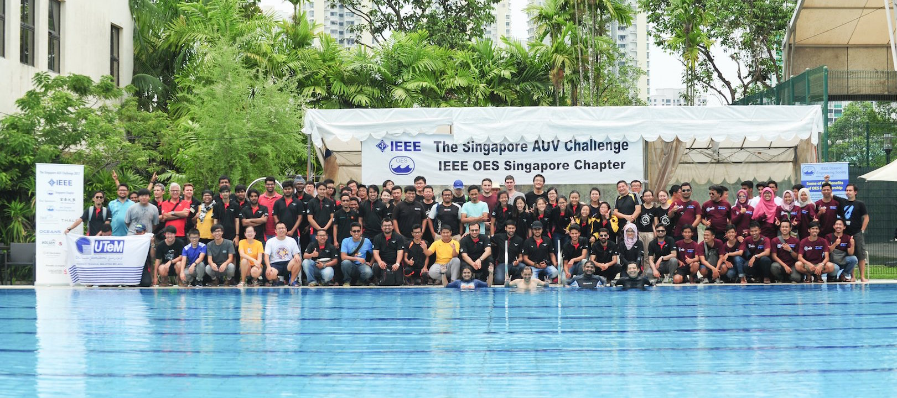

The SAUVC 2017 Participants.

## Structure of the Team

A team may consist of up to **11 participants** including **faculty supervisors**. There are two team categories, student and open. A team is in the student category if at least half of its participants are full-time students at the time of registration.

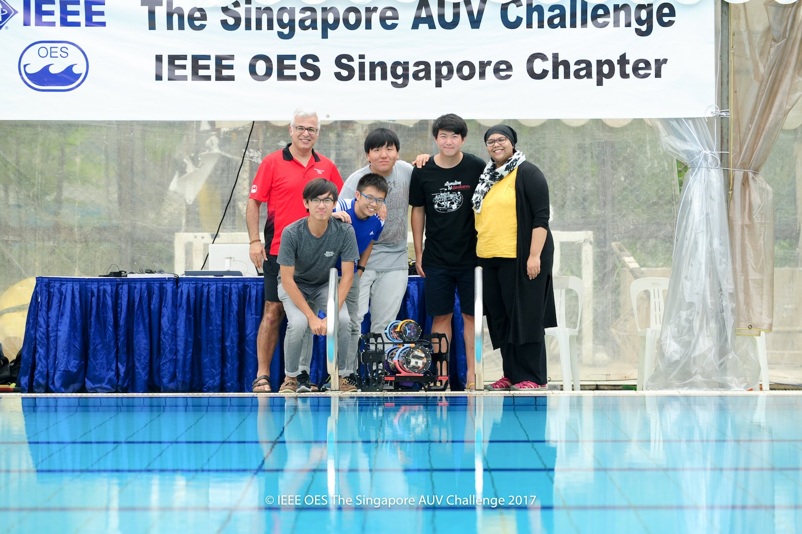

One of the teams with faculty co-supervisors from the 2017 Competition.

## Video Submission

All teams have to submit a video of their AUV prior to the competition. The video **HAS TO**

-  be **40 to 45 seconds** long,
-  be submitted before 23:59 20th December, 2026, [Anywhere On Earth](https://en.wikipedia.org/wiki/Anywhere_on_Earth),
-  show the AUV swimming underwater without a tether for at least **20 seconds**. In this time, the AUV must **dive, swim straight, turn 180° clockwise and swim back**.
-  show a person operating the [kill switch](#safety) **underwater**, and all thrusters stopping immediately.

**Note: The video will not be played beyond 45 seconds, so whatever you want to showcase, must be done strictly within the 45 seconds.**

For your video:
- Do not put important parts of the video (safety, control etc.) after 45 seconds. They will not be reviewed, without exception.
- Do not spend time on an intro about your team or university. It takes up valuable time in your video.

Videos will be reviewed by the organizing committee and **around 35 teams with the best vehicles will be short-listed to attend the competition. The above criteria are the basic necessary criteria, failing which the teams wont be short-listed.** The committee will set the exact number based on logistics.

- The Judges will check each video for authenticity.
- Teams may improve the AUV after the video, but must not change it significantly.
- Teams must not modify the kill switch shown in the video. The Judges reserve the right to disallow an AUV that breaks this rule.

The organizing committee reserves the right to publish the video submissions after the competition.

## Qualification

- To qualify, an AUV must swim from the **qualification starting line, pass completely through the qualification gate, perform a U-turn, and completely pass through the gate again**. Note: It is necessary to perform a U-Turn after passing through the gate in the forward run, before attempting the reverse run.
- "Passing through the gate" implies the back-most part of the AUV crosses the line.
- The AUV must complete the entire course without surfacing, touching the bottom, walls, or the qualification gate.
- Passing through the gate once (in the forward run) earns 1 qualification point. 2 qualification points are awarded only after the AUV passes through the gate both times (i.e, on both the forward and reverse run).
- The total run time will be measured from when the **AUV starts the qualification run to when it completely passes through the gate for the second time or when the team requests an abort**.
- Timing of the run will be used for tie-breakers only and does not directly contribute to the qualification score.
- Teams will be allocated a time slot for the qualification round. Teams may attempt multiple qualifying runs during the qualifying slot.
- If multiple qualifying runs are attempted during the qualifying slot, the most successful run will be considered for the final round (i.e the run with highest qualification points, and the fastest amongst those).
- **Only the top 15** qualified teams, with the highest qualification score, will advance to the final round.
- The qualification score, followed by the time taken to pass the qualifier round, decides the sequence in which the teams will participate in the final round of the competition. The team that finished the last in the qualifying round would participate first in the final round.

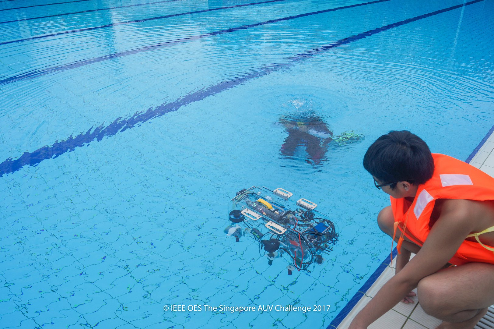

A team attempting qualification in the 2017 Competition.

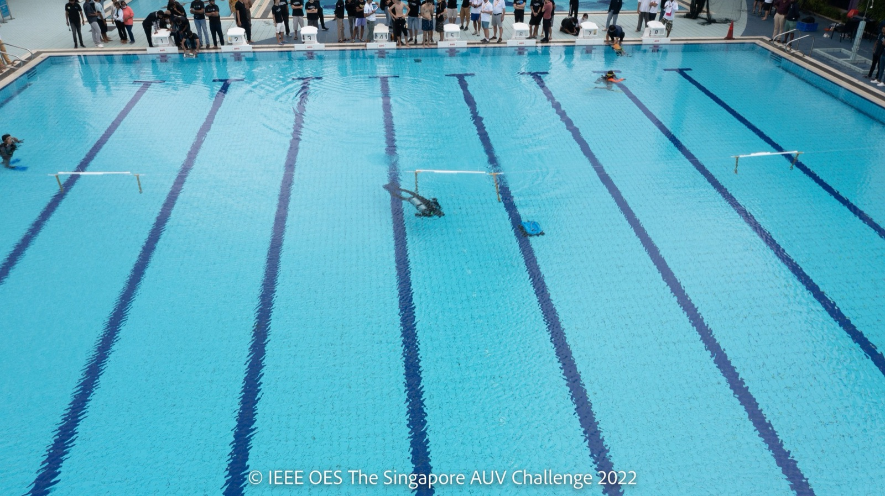

Top view of the qualification arenas from the 2022 Competition.

## The Arena

The challenge will be held in an olympic sized swimming pool (50m × 25m). Divers will be in the pool during the games.

![Diagram of the 50m × 25m pool. Three qualification arenas, each with a starting point and a qualification gate, run along a 10m strip at one end. In the 28m main arena: the 8m × 2m target zone with one blue and three red drums, a band where the red, yellow and blue flares are placed, the navigation gate line about 12m from the starting zone side, a 4m to 8m zone for the orange flare, the 140cm starting zone, and the 200cm Surfacing Square next to the qualification gates. The side view shows the pool floor sloping from 1.28m deep at the qualification gate to 2m deep in the main arena.](img/arena-2027.png)

Top & side views of the Arena (not to scale).

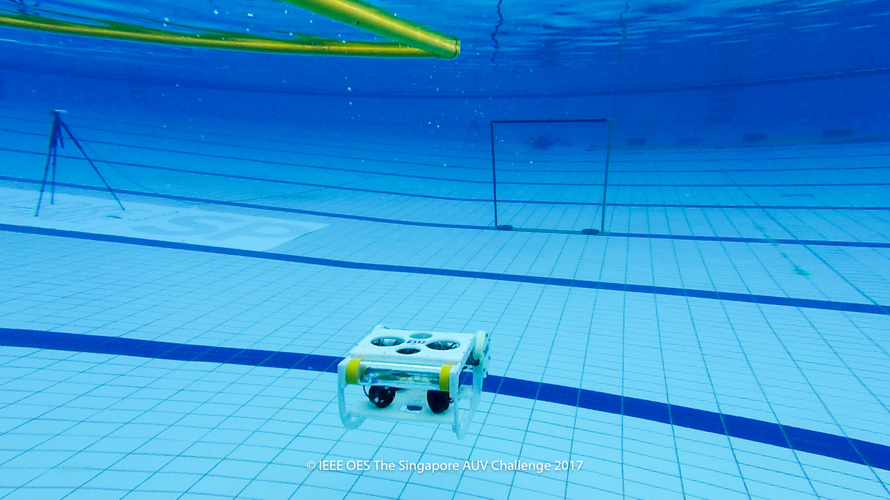

Picture of the Arena from 2017 Competition.

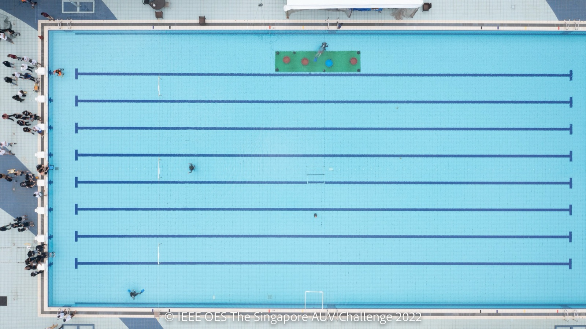

Picture of the Arena from 2022 Competition.

### Qualification Arena(s)
The qualification rounds would be held on the side of the main arena.

The qualification starting line is a marked 1m wide section of the pool wall from where the AUV should be deployed from. The AUV **has to touch the wall** at the beginning of the run.

At approximately 10m from the starting line the qualification gate is hanging from the surface of the water. The AUV has to go through the gate completely to get 1 qualifying point. If the AUV touches **ANY** of the 3 sides of the qualification gate, the attempt is considered a failure.

#### Specification of props

| Prop | Description |
|:--|:--|
| Qualification Gate | 150cm wide and ~100cm deep gate hanging from the water surface with orange markings on both port and starboard sides. |

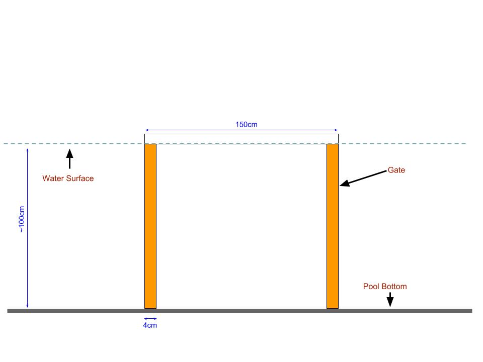

Front view of the qualification gate (not to scale).

### Starting Zone

The starting zone is a **140×140cm area** marked on the surface of water. The teams  **must** start their AUVs from this area. The team may only place the AUV at the water surface, it must autonomously submerge **before** leaving the starting zone. Teams may also place their [communication equipment](#communications) in the starting zone.

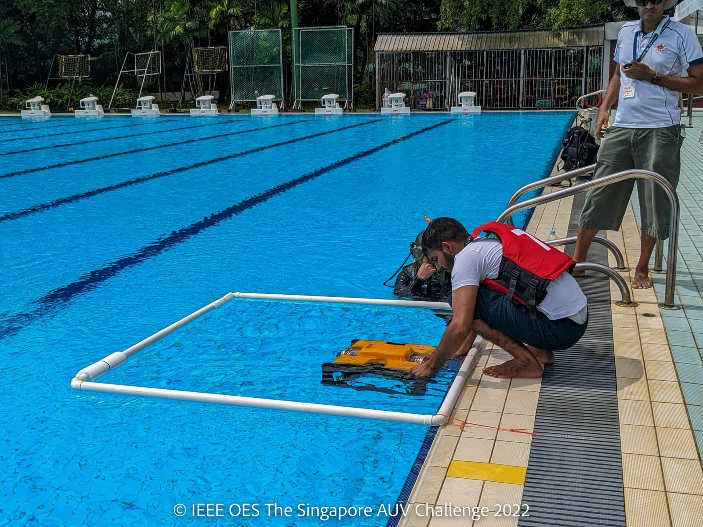

Picture of the Starting Zone from 2022 Competition.

## Tasks

There are 4 tasks in the challenge:

1. [Navigation](#navigation)
1. [Target Acquisition](#target-acquisition)
1. [Target Reacquisition](#target-reacquisition)
1. [Communication & Localization](#communication--localization)

The first task, Navigation, is mandatory and **must be completed** before attempting any other task. The other tasks can be attempted in any order. Surfacing at any point signifies end of the attempt.

### Navigation

The aim of this task is to swim through a gate placed at the bottom of the pool. The gate may be located anywhere on a horizontal line, parallel to the side of the swimming pool, approximately 12m away from the starting zone. See the [arena diagram](#fig-arena). The AUV has to swim through the 150cm tall gate. Touching the gate does not fail the task, but it costs a [penalty](#penalties).

**An orange flare** may be located anywhere in a rectangular zone 4m-8m from side of the arena, before the gate. The AUV **has to avoid** touching the orange flare. Any part of the AUV touching the orange flare causes an immediate abort of the attempt.

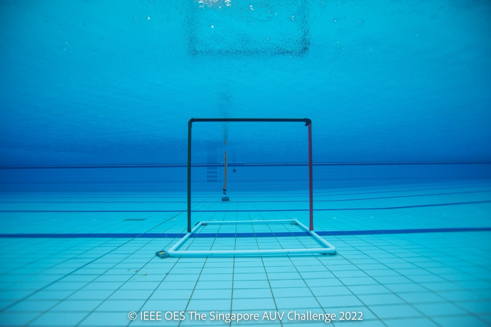

Picture of the gate from 2022 Competition.

#### Points

If the AUV successfully passes through the gate,15 Points will be awarded.

#### Specification of props

| Prop | Description |
|:--|:--|
| Gate | 150cm wide and 150cm tall gate with striped red and green markings on port and starboard sides respectively. |
| Orange Flare | 150cm tall and ~15cm diameter flare, and orange in colour. |

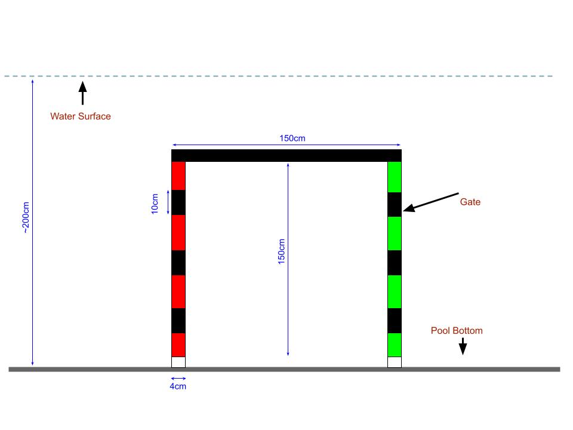

Front view of the gate (not to scale).

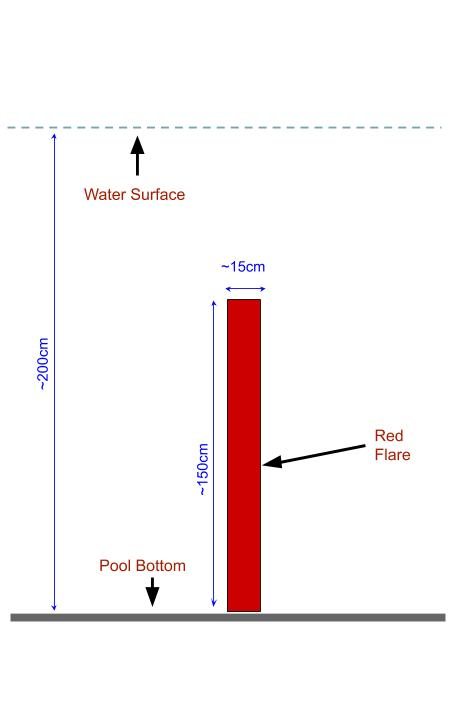

Front view of the orange flare (not to scale).

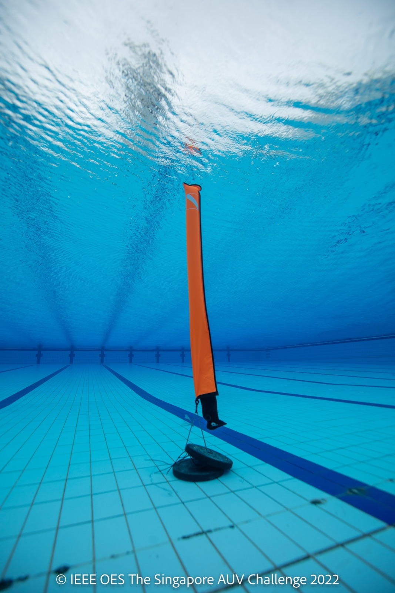

Orange flare from 2022 Competition. 

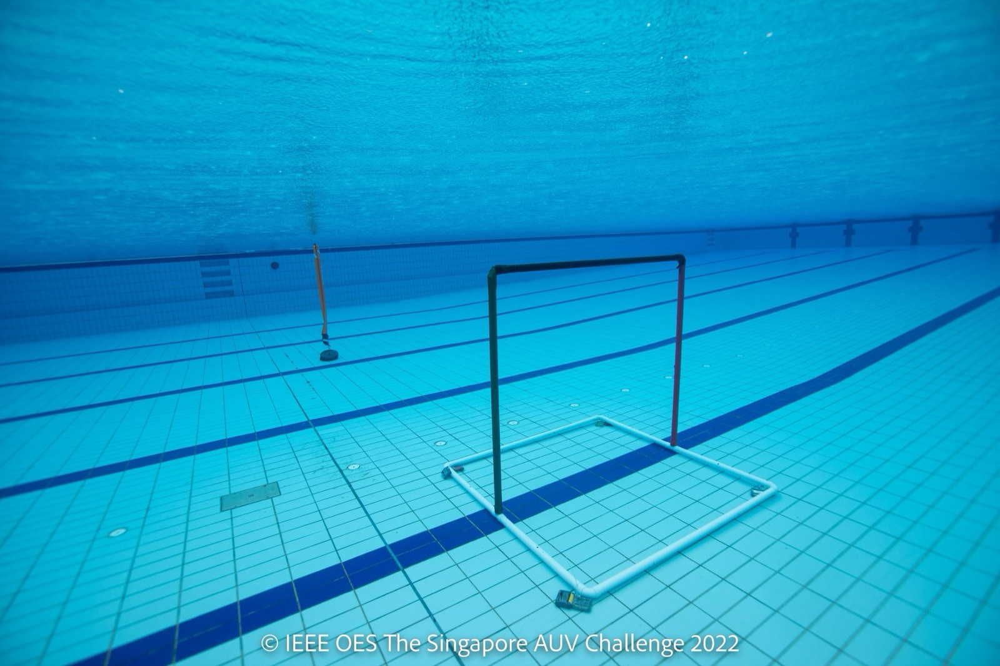

Gate and orange flare from 2022 Competition. 

### Target Acquisition

The aim of the task is to detect and acquire a target among a series of drums at the bottom of the pool, in the target zone.

A target zone is defined by a green coloured mat laid out on the floor of the pool. The mat is 8m × 2m in size. The [arena diagram](#fig-arena) shows where the mat is in the arena.

There are 4 coloured drums in the arena. All of them are on the mat. One of the drums, chosen at random, will be blue in colour, while the rest are red in colour. One of the red drums, chosen at random, will contain an acoustic pinger. The AUV needs to drop a ball in one of the drums to successfully complete this task. Points will be awarded based on which drum the ball is dropped into. In the event of multiple balls being dropped, only the **first ball** is taken to consideration.

The location of the red drum which contains the acoustic pinger may be randomized between attempts, as may be the order of the drums. The order of the drums and location of the pinger will be decided by the organizing committee.

#### Points

Points will be awarded as follows.

- Drop the ball in the blue drum: 30 Points
- Drop the ball in the red drum with the pinger: 50 Points
- Dropping the ball in any other red drum: 10 Points

#### Specification of props

| Prop | Description |
|:--|:--|
| Drum | 60cm in diameter and 30cm in depth. |
| Ball | 3.5-4.5cm in diameter and weighs no more than 200g in air. Provided by teams. |
| Drum Pinger | [RJE International Pinger Model No. ULB-362B/45 kHz](http://www.rjeint.com/wp-content/uploads/2017/01/ULB-362-ULB-362PL-Manual.pdf). |

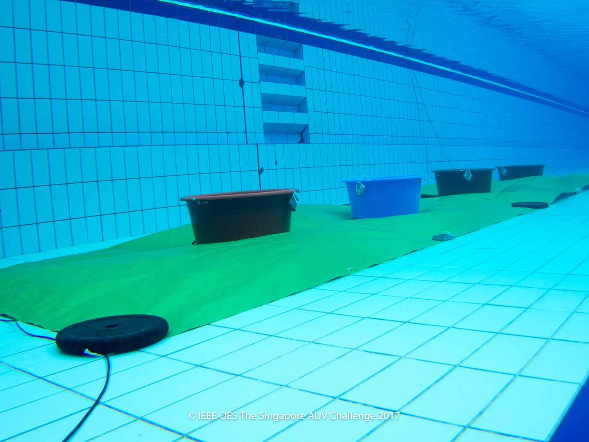

Picture of the target zone and drums from the 2017 Competition.

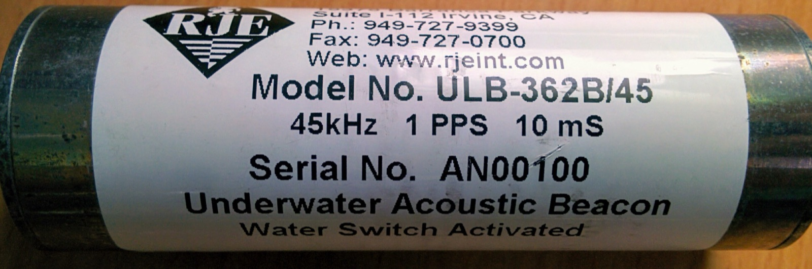

Picture of a 45kHz pinger.

### Target Reacquisition

The aim of this task is to reacquire a previously detected target.

This task is only attempt-able if the [Target Acquisition](#target-acquisition) has been successfully completed. Furthermore, the AUV has to leave the target zone, before it can attempt the Target Reacquisition task. Every part of the AUV needs to clear the target zone, before it can be considered outside the target zone.

After the AUV is outside the target zone, it needs to reacquire the target and pick up the ball that it dropped in the [Target Acquisition](#target-acquisition) task. The AUV has to hold on to the ball till the end of attempt to successfully complete this task.

This task does not have to be attempted immediately after Target Acquisition task, other tasks may be attempted in between.

#### Points

If the AUV successfully picks up the ball and holds on to it till the end of the attempt, 60 Points will be awarded.

#### Specification of props

| Prop | Description |
|:--|:--|
| Target zone | Green mat 8m × 2m in size. |
| Ball | Same ball used in target acquisition task. Provided by the teams. |

### Communication & Localization

The aim of this task is to localize on coloured flares and bump them causing a golf ball to drop out. There are **3 coloured flares** in the arena, one **red coloured flare**, one **yellow coloured flare** and one **blue coloured flare**. These flares could be located **anywhere** within the main arena. The AUV may locate and bump the flares in **a specified order**, which may be communicated to the AUV, to receive bonus points.

On every attempt, after the AUV successfully completes the _Navigation task_, the team will be informed of the **order** in which the flares have to be bumped. The **specified order** may be different between different attempts. The order will be specified using the following notation, joined by a hyphen (-).

- Red : **R**
- Yellow : **Y**
- Blue : **B**

So, for example, specifying the order as **R-B-Y** would mean that the AUV has to bump the **red flare** first, followed by the **blue flare** and finally the **yellow flare**.

The team is then allowed to communicate the **order** with their AUVs using their [communication equipment](#communications).

#### Points

Points would be awarded as follows.

- Successfully causes the ball to drop from any flare via contact or proximity : 20 Points per flare
- Successfully causes the ball to drop all 3 flares in the **specified order** : 60 Points (in addition to above)

#### Specification of props

| Prop | Description |
|:--|:--|
| Red Flare | 80cm tall, ~1.6cm in diameter, and red in colour. |
| Yellow Flare | 80cm tall, ~1.6cm in diameter, and yellow in colour. |
| Blue Flare | 80cm tall, ~1.6cm in diameter, and blue in colour. |
| Golf Ball | A standard golf ball resting on top of each flare. |

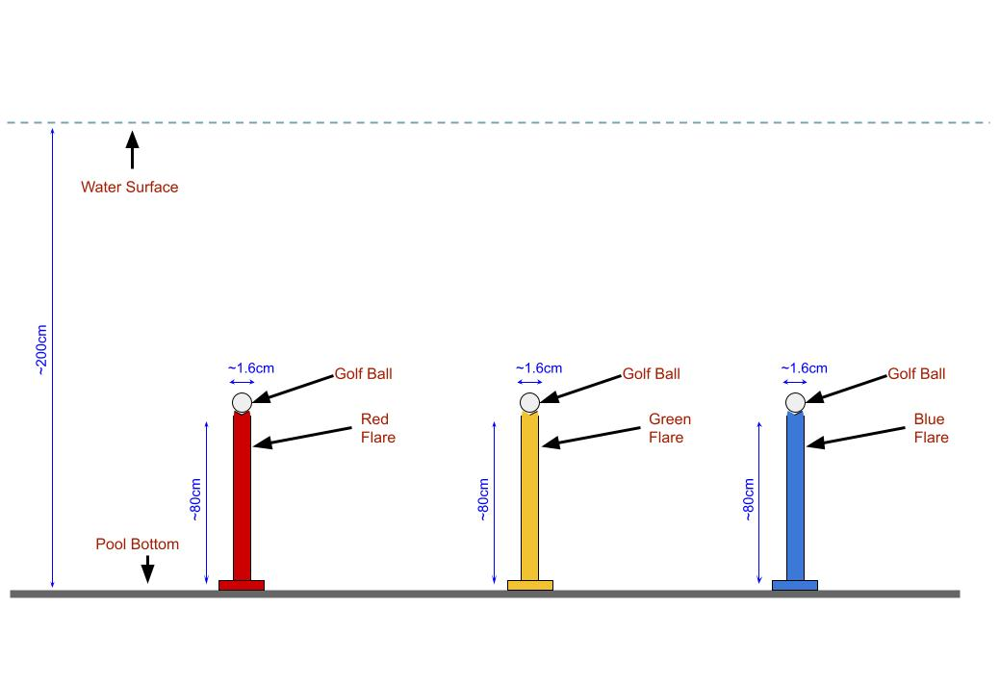

Side view of the flares (not to scale).

### Surfacing

Breaching the surface at any point during the attempt causes end of the current attempt, the total points for that attempt will be computed based on the tasks accomplished in that attempt and the timing bonus (if applicable) and a 5 Points surfacing bonus for ending. The team may wish to retry if they still have time left.

#### Surfacing Square Bonus

The Surfacing Square floats on the water surface next to the qualification gates. If the AUV has completed the Navigation task and surfaces inside the Surfacing Square **without touching ANY side of the square**, the team gets a 20 Points Surfacing Square bonus on top of the surfacing bonus.

If the AUV touches any side of the square while surfacing, or surfaces outside it, this counts as a normal surface and the team gets only the surfacing bonus.

#### Specification of the Surfacing Square

| Prop | Description |
|:--|:--|
| Surfacing Square | 200×200cm PVC pipe frame floating on the water surface, held in place by a line. Blue markers hang about 30cm below the frame to make it visible from underwater. |

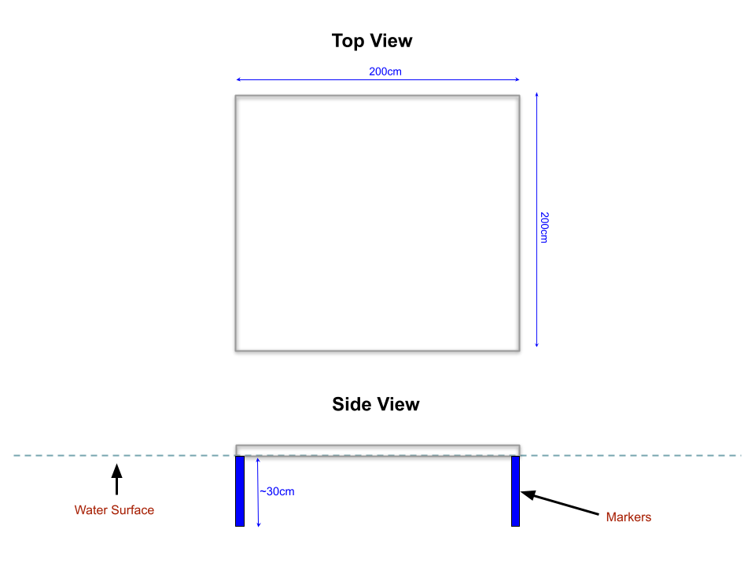

Top & side views of the Surfacing Square (not to scale).

### Aborting

At any time during the attempt, the current attempt can be aborted, by indicating to the Game Master. The divers would then retrieve the AUV back to the starting zone. The timing for the current attempt is stopped at the time of indication. The team may wish to retry if they still have time left.

In the case of an aborted attempt, the team would be awarded the points for all previously successfully completed tasks during the current attempt. Penalties incurred during the attempt still count towards that attempt's score.

### Automatic Abort

If the AUV touches the bottom or the side walls of the pool for **a cumulative time of more than 10 seconds or 5 discrete touches**, the current attempt would be automatically aborted. The divers would then retrieve the AUV back to the starting zone. The team may wish to retry if they still have time left.

In the case of an automatic aborted attempt, the team would be awarded the points for all previously successfully completed tasks during the attempt. Penalties incurred during the attempt, including the touches that caused the automatic abort, count towards that attempt's score.

### Timing Bonus

At the end of an attempt, as long as the AUV has successfully completed at least **2 tasks**, the Navigation task and any other task, bonus points proportional to the remaining time will be awarded in accordance with the following formula.

`Bonus points = (900 − RUN_TIME) × 0.03`

RUN_TIME is the time in seconds from when the AUV starts thrusting from the starting zone until the end of the attempt.

For example, for a run time of 420s, Bonus = (900 − 420) × 0.03 = 14.4 Points.

### Penalties

There are penalty points for touching the floor or a wall of the pool at any time, and for touching the gate. The penalty points are:

| Description | Penalty Points |
|:--|--:|
| Touching the gate | 2 |
| Touching the bottom of the pool or wall | 5 |

Penalties count towards the attempt in which they happen, however the attempt ends, including when it is aborted or automatically aborted.

There is no penalty for your actuator touching the inner part of the drum during the act of deploying or retrieving during Target Acquisition and Target Reacquisition. However, touching the outer part of the drum or with the vehicle body can incur the same penalty as touching the pool floor.

### Examples

Here are some example scenarios and how they would be scored. They assume the AUV does not earn the size or weight bonus.

#### Example 1

- Team launches AUV from starting zone.
- AUV crosses the gate and completes the Navigation task, but touches the side of the gate while passing through.
- AUV can't find the location of the next task and ends the attempt by rising to the surface outside the Surfacing Square.
- The team gets the surfacing bonus, but not the Surfacing Square bonus.

| Task | Points |
|:--|--:|
| Navigation Task | 15 |
| Touching the gate | −2 |
| Surfacing Bonus | 5 |
| Surfacing Square Bonus | 0 |
| **Attempt Total** | **18** |

#### Example 2

- Team launches AUV from starting zone.
- AUV crosses the gate and completes the Navigation task.
- AUV can't find the location of the next task and has to be aborted and retrieved by divers.
- The AUV did not surface, so the team gets no surfacing bonus and no Surfacing Square bonus.

| Task | Points |
|:--|--:|
| Navigation Task | 15 |
| Surfacing Bonus | 0 |
| Surfacing Square Bonus | 0 |
| **Attempt Total** | **15** |

#### Example 3

- Team launches AUV from starting zone.
- AUV crosses the gate and completes the Navigation task.
- AUV finds the drums and successfully drops the ball in the blue drum, but touches the side of the wall momentarily while looking for the drum.
- AUV tries to find the flares, but can't find it and has to be aborted and retrieved by divers.
- The AUV did not surface, so the team gets no surfacing bonus and no Surfacing Square bonus.

| Task | Points |
|:--|--:|
| Navigation Task | 15 |
| Target Acquisition Task (blue drum) | 30 |
| Touching the wall | −5 |
| Surfacing Bonus | 0 |
| Surfacing Square Bonus | 0 |
| **Attempt Total** | **40** |

#### Example 4

- Team launches AUV from starting zone.
- AUV crosses the gate and completes the Navigation task.
- AUV finds the drums and successfully drops the ball in the blue drum.
- AUV locates the red flare and knocks off the golf ball.
- AUV surfaces outside the Surfacing Square with run time of 400 seconds.
- The team gets the surfacing bonus, but not the Surfacing Square bonus.

| Task | Points |
|:--|--:|
| Navigation Task | 15 |
| Target Acquisition Task (blue drum) | 30 |
| Communication & Localization Task | 20 |
| Surfacing Bonus | 5 |
| Surfacing Square Bonus | 0 |
| Timing Bonus | 15 |
| **Attempt Total** | **85** |

#### Example 5

- Team launches AUV from starting zone.
- AUV crosses the gate and completes the Navigation task.
- Team is given the sequence of R-B-Y for the flares.
- AUV finds the drums and successfully drops the ball in the blue drum.
- AUV locates the red flare and knocks off the golf ball.
- AUV locates the yellow flare and knocks off the golf ball.
- AUV touches the bottom of the pool for more than 10 seconds while trying to find 3rd flare and gets automatically aborted by divers.
- The penalty for touching the bottom of the pool still counts towards this attempt.
- The AUV did not surface, so the team gets no surfacing bonus and no Surfacing Square bonus.

| Task | Points |
|:--|--:|
| Navigation Task | 15 |
| Target Acquisition Task (blue drum) | 30 |
| Communication & Localization Task | 40 |
| Touching the bottom of the pool | −5 |
| Surfacing Bonus | 0 |
| Surfacing Square Bonus | 0 |
| **Attempt Total** | **80** |

#### Example 6

- Team launches AUV from starting zone.
- AUV crosses the gate and completes the Navigation task.
- Team is given the sequence of R-B-Y for the flares.
- AUV finds the drums and successfully drops the ball in the blue drum.
- AUV locates the red flare and knocks off the golf ball.
- AUV locates the yellow flare and knocks off the golf ball.
- AUV locates the blue flare and knocks off the golf ball.
- AUV touches the bottom of the pool for more than 10 seconds while trying to find the Surfacing Square and gets automatically aborted by divers.
- The penalty for touching the bottom of the pool still counts towards this attempt.
- The AUV did not surface, so the team gets no surfacing bonus and no Surfacing Square bonus.

| Task | Points |
|:--|--:|
| Navigation Task | 15 |
| Target Acquisition Task (blue drum) | 30 |
| Communication & Localization Task | 60 |
| Touching the bottom of the pool | −5 |
| Surfacing Bonus | 0 |
| Surfacing Square Bonus | 0 |
| **Attempt Total** | **100** |

#### Example 7

- Team launches AUV from starting zone.
- AUV crosses the gate and completes the Navigation task.
- Team is given the sequence of R-B-Y for the flares.
- AUV finds the drums and successfully drops the ball in the blue drum.
- AUV locates the red flare and knocks off the golf ball.
- AUV locates the blue flare and knocks off the golf ball.
- AUV locates the yellow flare and knocks off the golf ball.
- AUV surfaces outside the Surfacing Square with run time of 400 seconds.
- The team gets the surfacing bonus, but not the Surfacing Square bonus.

| Task | Points |
|:--|--:|
| Navigation Task | 15 |
| Target Acquisition Task (blue drum) | 30 |
| Communication & Localization Task | 120 |
| Surfacing Bonus | 5 |
| Surfacing Square Bonus | 0 |
| Timing Bonus | 15 |
| **Attempt Total** | **185** |

#### Example 8

- Team launches AUV from starting zone.
- AUV crosses the gate and completes the Navigation task.
- AUV finds the drums and successfully drops the ball in the blue drum.
- AUV locates the red flare and knocks off the golf ball.
- AUV swims to the Surfacing Square and surfaces inside it without touching any side. The run time is 520 seconds.
- The team gets the surfacing bonus and the Surfacing Square bonus.

| Task | Points |
|:--|--:|
| Navigation Task | 15 |
| Target Acquisition Task (blue drum) | 30 |
| Communication & Localization Task | 20 |
| Surfacing Bonus | 5 |
| Surfacing Square Bonus | 20 |
| Timing Bonus | 11.4 |
| **Attempt Total** | **101.4** |

#### Example 9

- Team launches AUV from starting zone.
- AUV crosses the gate and completes the Navigation task.
- AUV finds the drums and successfully drops the ball in the blue drum.
- AUV locates the red flare and knocks off the golf ball.
- AUV swims to the Surfacing Square, but touches a side of the square while surfacing. The run time is 520 seconds.
- This counts as a normal surface, so the team gets the surfacing bonus, but not the Surfacing Square bonus.

| Task | Points |
|:--|--:|
| Navigation Task | 15 |
| Target Acquisition Task (blue drum) | 30 |
| Communication & Localization Task | 20 |
| Surfacing Bonus | 5 |
| Surfacing Square Bonus | 0 |
| Timing Bonus | 11.4 |
| **Attempt Total** | **81.4** |

#### Example 10

- Team launches AUV from starting zone.
- AUV misses the gate and does not complete the Navigation task.
- AUV surfaces inside the Surfacing Square without touching any side.
- The AUV did not complete the Navigation task, so the team gets the surfacing bonus, but not the Surfacing Square bonus.

| Task | Points |
|:--|--:|
| Surfacing Bonus | 5 |
| Surfacing Square Bonus | 0 |
| **Attempt Total** | **5** |

## Specification of AUV

### Size

The Judges measure size and weight at, or right before, deployment. These measurements count towards the limits and bonuses below. Cables and antennas that hang over the AUV count towards its size and weight. Parts that extend and retract during a run do not count towards its size, but still count towards its weight.

- The AUV must fit within a 140 × 100 × 100 cm box.
- An AUV with dimensions of less than 70 cm × 50 cm × 50 cm will be given bonus 10 points.
- The AUV must not weigh more than 52 kg in air.
- An AUV weighing less than 42 kg in air will be given bonus 10 points.

The size and weight bonuses are added to the score of every attempt.

### Power

- Power must be self contained.
- **Tethers of any sort are not allowed**, except when [calibrating AUV sensors during practice rounds](#practice-rounds).
- The voltage of the power source used by each AUV must not exceed 24VDC.

### Safety

- AUVs must not leak and pollute the pool.
- AUVs must be designed and manufactured as to pose no danger of any kind to anyone or anything at the venue. This includes making sure that thrusters/propeller blades are shrouded.
- AUVs **must have a kill switch** that turns off the vehicle including thrusters, or any other propulsion mechanism.
- The kill switch must be **easy to reach** and **easy to operate** for a diver underwater. This must be marked in bright colour.
- The kill switch must be the same as the one shown in the [video submission](#video-submission).
- Pressure of any compressed gas used must not exceed **6 bars**.
- The use of explosives, fire or hazardous chemicals is prohibited. Certified lithium batteries are allowed.
- If lasers are used, they must be of class 2 or lower. Care must be taken to protect all persons at the venue from harm. Beams must be oriented in such a fashion that they cannot shine into the eyes of the spectators.
- The Judges reserve the right to **disallow any team** whose AUV does not meet these safety rules, including the kill switch rules, from taking part in the competition.

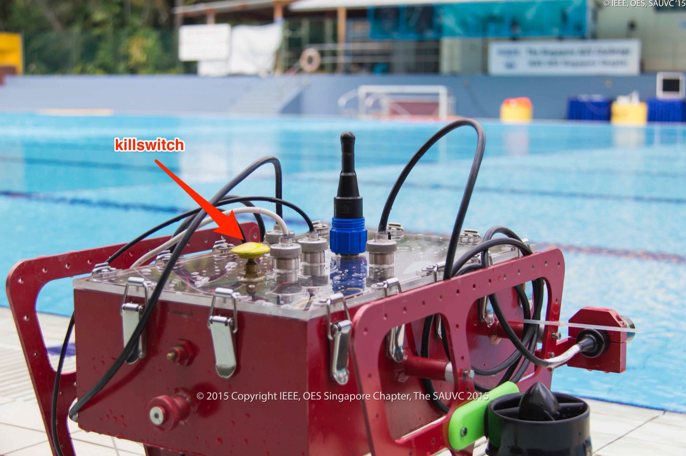

Example of a kill switch on an AUV from 2015 Competition.

### Communications

- Untethered communications with the AUV **are allowed** in the main arena.
- AUVs can carry their own "underwater" communication equipment.
- Teams are allowed to deploy "top-side" communication equipment in the starting zone during the game.
- All "underwater" communication equipment on the AUV _MUST fit_ within the size limits for the AUV.
- Any "underwater" communication equipment on the AUV is considered a part of the AUV.
- The "top-side" communication equipment _MUST fit_ within the dimensions of the starting zone and weigh no more than 42 kg in air.
- Any "top-side" communication equipment must stay within the starting zone. It may be submerged in the water, and can have **a single tether** to the surface.
- Any "top-side" communication equipment submerged in the water, must not leak and pollute the pool.
- Any "top-side" communication equipment must be removed at the end of the game.

## Game Procedure

### Sequence of events during the competition

- AUVs will undergo weight and size check. Bonus points, if applicable, will be awarded.
- AUVs will be tested for battery, oil or lubricant leak check, and a waterproofness check. Failing any of these checks would bar the team from attempting to qualify until the AUV passes the checks.
- Team will proceed to qualifying round. The bonus points for size and weight is applicable only if the team passes the qualifying round.
- Top 15 qualified teams (according to qualification score and the qualification time) will proceed to the final rounds of competition. The organizing committee reserves the right to change the number of teams in the final based on logistical constraints.
- The final round will be held in the main arena.

### Practice Rounds

- Teams will be allowed to practice in the main arena after they successfully complete the qualifying round, subject to availability of time slots and the schedule during the competition.
- No tethers are allowed at ANY time inside the main arena, except in and under the starting zone.
- Teams will be allowed to calibrate their AUV sensors with tethers, at the edge of the pool, with the vehicle held **stationary**.

### Length of a game

- Each team is given **15 minutes** to complete the tasks.
- In any of the following cases, the game ends immediately.
  - Disqualification is announced in the game.
  - When the Judges determine that the game cannot continue.
- Setting up of AUV
  - Five minutes is given for setting up the AUV before the game starts.
  - No more than two members of respective teams can engage in setting up of their AUV at the poolside.
  - The two designated members setting up must wear life jackets. Failure to do so may result in disqualification.
  - Any team that fails to complete setting their AUV within five minutes can resume the setting up again once the game starts.
  - Setting up during the game uses the allocated time for the tasks and game.
  - The AUV can only start from the starting zone. This is the only place where the AUV is allowed to be on the water surface.
  - The AUV must start its maneuver only after it has **completely submerged** in the water.

### Retries

- A retry attempt can be made only after the Judges' permission.
- The AUV will be passed to the two designated team members standing beside the pool by the divers.
- A retry would mean that the AUV starts from the starting zone with 0 points
- A maximum of 15 minutes is allowed including all the retries.
- The attempt with the highest score (including retries) will be considered for final scoring.

## Certificate of Participation

- Teams whose AUVs successfully complete the qualifier round will receive Certificate of Participation.
- Teams whose video submissions have been accepted & attend the competition will receive a Certificate of Participation.
- Failing the above two criteria, no Certificate of Participation will be awarded.

## General Restrictions

- Team members are not allowed to enter the swimming pool at any point during the game.
- Team members may not disturb the water surface once the game starts, except when handling their AUV or "top-side" communication equipment in the starting zone.
- Members of other teams are not allowed in the game area.
- Nobody is allowed to wear any footwear near the pool area.
- The Judges may suspend the challenge if weather turns unfavorable.
- The pool area must be evacuated in case of lightning.

## Disqualification

Teams may be disqualified if :

- Oil or lubrication leaks causing the pollution of pool.
- Battery leak causing the pollution of pool.
- The AUV damages or tries to damage the arena, facilities or equipment.
- The team performs any acts that are not in the spirit of fair play.
- The team fails to obey instructions or warnings issued by the Judges or Game Master.
- If the team does not abide by the general restrictions.

## Others

- The legitimacy of any actions not provided in this rulebook will be subject to discretion of the Judges.
- The dimensions, weights, etc. of the field, facilities and equipments stated in this rulebook have a margin of error of ±5% unless otherwise stated. However the dimensions and weights of the AUVs as stated in the rule book are the maximum and cannot be deviated.
- The Judges may demand additional explanations on safety issues when the safety of a vehicle is deemed to be in question.

## Feedback

If you spot any errors in the rulebook or have queries about the rules, please email rules@sauvc.org or contact us through [our website](https://sauvc.org/#contact).
